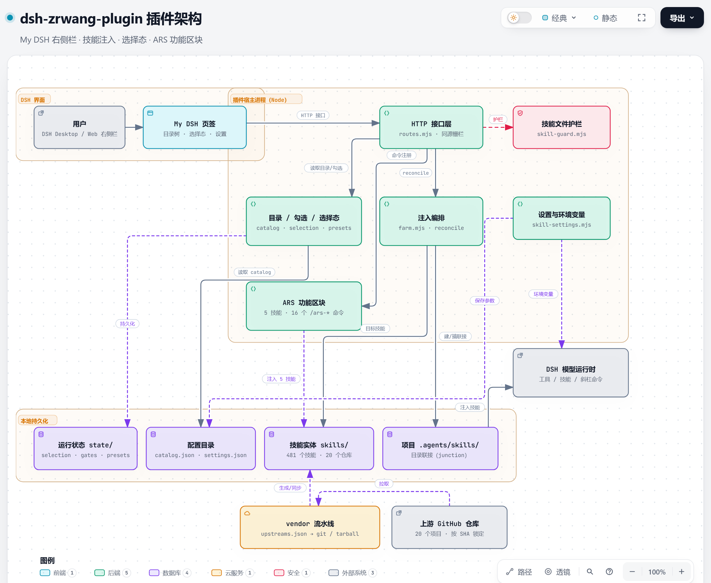

# dsh-zrwang-plugin（My DSH）

王湛然的DSH管理插件：按项目、按对话控制「注入哪些技能」&「注入哪些功能」，把 20 个上游 GitHub 技能仓库、481 个技能收进一个统一入口，并保留一些项目特有的功能。

当前版本 **0.1.0**。


## 它解决什么

1. DSH 的技能来自 `.agents/skills/`，一个项目里装几十上百个技能会互相干扰、难以挑选。这个插件把技能按「工程 / 科研 / 办公」三组做成目录树：
- 勾选即注入，取消即摘除；同一份技能只存在插件包里，不在每个项目重复复制。
- 按项目保存「默认」注入态，按对话派生临时「未命名」态，右键可基于、改名、删除。
- 481 个技能全部可用，默认不注入任何技能（门禁全关），用哪组开哪组。
- 每个技能都能一键打开上游 GitHub 项目；中文短说明与详情在侧栏直接看。

2. 好多好用的AI生态项目都是面向Claude Code/Codex,其余Harness本身无法使用，但是**deepseek**官方给出了具备了「一些皆插件」理念的Deepseek Harness 和 具有「许愿式编程」能力的 deepseek v4.1 flash-1017，给予了像我这种非IT从业者去**优化&改进&修饰&...**自己的Harness，让自己的Harness更适合自己使用，所以可以把很多有趣/好用的项目集成进自己的DSH中。

## 架构



- 浏览器侧只有「My DSH」页签；所有状态与技能实体都在宿主进程和本地磁盘。
- 宿主进程负责目录、勾选、选择态、注入编排、写操作护栏、ARS 命令与设置。
- `skills/`、`state/` 与配置目录分离：技能实体来自 vendor 流水线，状态可随时重建。

## 功能

- **三级目录树**：工程技能组 223 个、科研技能组 239 个、办公技能组 19 个，共 **481 个技能**，来自 **20 个上游仓库**。
- **技能选择态（按项目 + 对话）**
  - 每个项目初始只有「默认」：基础注入态，所有门禁关闭，**注入数恒为 0**；只读，不因侧栏勾选而改变。
  - 在「默认」上做任何修改（勾技能、开分组、开 ARS）会自动派生当前对话的「未命名」，自动保存。
  - 每个对话最多一个「未命名」，没改名之前别的对话/项目都看不到；右键「重命名」后升级为项目级模式，同项目其他对话可见。
  - 右键菜单：**基于此新建 / 重命名 / 删除**；删掉当前模式会回到「默认」。
- **逐层与批量**：目录行的「全选 / 全关」只作用于**直接下一层**（子技能勾选、子目录门禁），不会递归下钻。
- **技能详情**：中文短说明一行、详情按 Markdown 渲染，含表格、列表、代码与链接；详情读不出来时提示打开 SKILL.md。
- **上游链接**：每个「项目根」（如 MATLAB、沁言学术技能、中国专利技能、ARS）右侧有 **↗**，在浏览器打开对应 GitHub 仓库；项目内部的子目录/技能不重复显示。
- **写操作护栏**：模型用 write/edit 改插件内 `skills/`、`ars/` 一律拒绝（含经项目目录联接写入），避免跑任务时改坏技能。
- **ARS 学术研究**：固定区块（默认关闭），勾选后注入 5 个流水线技能并提供 16 个 `/ars-*` 命令；多角色流程要求 DSH 开启 Agent Team。

## 安装

需要 DSH Desktop `0.2.1-rc.1` 或更高版本。

在 DSH 里打开「设置 → 插件 → 安装插件」，搜索并安装：

```text
dsh-zrwang-plugin
```

也可以直接用命令行安装到当前 profile：

```powershell
dsh plugin --profile desktop add dsh-zrwang-plugin
```

安装后重启 DSH 并刷新页面，右侧栏的 `+` 里会出现「My DSH」。

> 右侧栏依赖 `dsh-better-sidebar`；没有的话先安装它。

## 使用

1. 打开右侧栏「My DSH」，在搜索框里按技能名、类别或说明过滤。
2. 展开「工程技能组 / 科研技能组 / 办公技能组」，打开需要的一级目录。
3. 勾选技能，或点目录行的「全选 / 全关」批量处理直接下一层。
4. 在侧栏底部切换选择态；右键模式可基于此新建、重命名或删除。
5. 技能行「详情」展开中文说明，「打开」在右侧栏查看 SKILL.md，「↗」在浏览器打开上游项目。

底部「学术研究（ARS）」与三个技能组排在一起：默认不勾选，勾选后注入 5 个论文流水线技能，并提供 `/ars-plan`、`/ars-full`、`/ars-lit-review`、`/ars-reviewer`、`/ars-revision` 等 16 个命令。多角色流程依赖 DSH 的 **Agent Team**，未开启时对应命令会提示先开启。

## 设置

「设置 → 插件 → My DSH」按用途分栏：

| 栏目 | 内容 |
| --- | --- |
| ARS 设置 | Python 解释器、Python 依赖检查（PyYAML、jsonschema、pypdf 等） |
| 模型服务 | 生图模型（ppt-master）、OCR 模型、OpenRouter（生图/幻灯片技能） |
| Nature-skill 设置 | PubMed / Crossref / arXiv 检索参数、百度 OCR Token |
| 科研信息 | 沁言学术 API、Parallel、Zotero 文献库；PubMed/NCBI 复用 Nature 里的配置 |

保存的密钥写入宿主进程环境（`QINYAN_API_KEY`、`OPENROUTER_API_KEY`、`ZOTERO_*`、`NCBI_*` 等），模型执行脚本时子进程直接继承；沁言学术与 pyzotero 未配置时对应技能在侧栏置灰。

## 技能来源

| 分组 | 技能数 | 说明 |
| --- | --- | --- |
| 工程技能组 | 223 | MATLAB / Simulink / Polyspace / 示例 |
| 科研技能组 | 239 | Nature、Zotero、沁言学术（187）、NSFC、HKUST 导师、中国专利（9）、学术去 AI 味等 |
| 办公技能组 | 19 | OfficeCLI、PPT Master、HTML PPT、Archify、图表、公文、归藏 PPT、前端幻灯片等 |
| 学术研究（ARS） | 5 + 16 命令 | 独立功能区块，不占技能树 |

中文短说明与详情由脚本从各技能 `SKILL.md` 的 description 生成（Google 翻译，已是中文的保持原文），缓存留在过程目录，可重复生成。

## 完整性与许可

- 上游完整性：`node scripts/audit-upstreams.mjs --proxy=http://127.0.0.1:7897` 按 `vendor/upstreams.lock.json` 的 SHA 重新下载并逐技能核对文件清单；当前 20 仓库 / 481 技能全部通过。
- 各上游许可保留在 `vendor/licenses/<仓库>/`；`nsfc-agent-skills` 上游没有 LICENSE（仅本地使用）、`guizang-ppt-skill` 为 AGPL-3.0、Supervisor 为 CC BY-NC-SA、lieflat 系为 CC BY-NC / PolyForm Noncommercial，公开再分发前需逐个确认。
- 插件代码为 MIT。

## 开发

```powershell
node --check host\*.mjs            # 语法
node scripts/build-client.mjs      # 改了 client/ 必须重新构建
node scripts/verify.mjs            # 包/目录/中文/默认集合/客户端语法全检
node scripts/smoke-host.mjs        # 宿主冒烟（不装 DSH）
```

架构与实现细节见 [docs/architecture.md](docs/architecture.md)，ARS 用法见 [docs/ars-usage.md](docs/ars-usage.md)。

## 卸载

```powershell
dsh plugin --profile desktop remove dsh-zrwang-plugin
```

项目里的技能链接会随取消勾选自动移除；插件包本身不会被删除。

## 致谢

本插件的技能来自以下开源项目，感谢作者和维护者：

- [MATLAB Agentic Toolkit](https://github.com/matlab/matlab-agentic-toolkit)
- [Simulink Agentic Toolkit](https://github.com/matlab/simulink-agentic-toolkit)
- [Polyspace Agentic Toolkit](https://github.com/mathworks/polyspace-agentic-toolkit)
- [MATLAB Agent Skills Playground](https://github.com/matlab/agent-skills-playground)
- [Nature Skills](https://github.com/yuan1z0825/nature-skills)
- [OfficeCLI](https://github.com/iOfficeAI/OfficeCLI)
- [PPT Master](https://github.com/hugohe3/ppt-master)
- [HTML PPT Skill](https://github.com/lewislulu/html-ppt-skill)
- [Zotero MCP](https://github.com/54yyyu/zotero-mcp)
- [Archify](https://github.com/tt-a1i/archify)
- [Academic Research Skills（ARS）](https://github.com/Imbad0202/academic-research-skills)——CC-BY-NC-4.0
- [Academic Humanizer](https://github.com/AIScientists-Dev/academic-humanizer)——MIT
- [Lieflat Less AI Tone](https://github.com/larashero3-dotcom/lieflat-less-ai-tone)——CC BY-NC 4.0
- [Qinyan Academic Skills](https://github.com/LeonChaoX/qinyan-academic-skills)——MIT
- [NSFC Agent Skills](https://github.com/njzjz/nsfc-agent-skills)——无 LICENSE（仅本地使用）
- [Supervisor Skills](https://github.com/HKUSTDial/Supervisor-Skills)——CC BY-NC-SA 4.0
- [Lieflat Charts](https://github.com/larashero3-dotcom/lieflat-charts)——PolyForm Noncommercial 1.0.0
- [Writing DNA](https://github.com/larashero3-dotcom/writing-dna-skill)——MIT
- [Lieflat Gongwen](https://github.com/larashero3-dotcom/lieflat-gongwen)——PolyForm Noncommercial 1.0.0
- [Guizang PPT Skill](https://github.com/op7418/guizang-ppt-skill)——AGPL-3.0
- [Frontend Slides](https://github.com/zarazhangrui/frontend-slides)——MIT
- [Patent Disclosure Skill](https://github.com/handsomestWei/patent-disclosure-skill)——MIT

> 各上游技能的许可保留在 `vendor/licenses/<上游>/`。

[](https://github.com/deepseek-ai/deepseek-harness)
