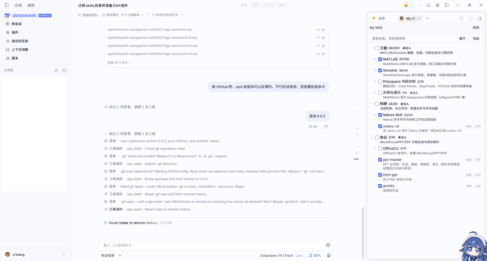

# 王湛然的 DSH 管理插件

王湛然的 DSH 管理插件是一个 DSH Desktop 右侧栏插件，用来按会话选择要启用的技能。勾选后插件会把对应技能接到当前项目里，取消勾选就收回；同一份技能只保存在插件包中，不会在每个项目里重复复制。




## 功能

- 右侧栏新增「My DSH」页签，按工程、科研、办公分组浏览技能。
- 支持逐级开关：打开父目录后，该目录下已选技能才会注入；关闭父目录只影响它下面的技能。
- 技能详情可直接在侧栏查看中文说明。
- 设置页可配置图片服务、Nature 检索和图片转 PPT 参数，密钥不会回显。

## 安装

需要 DSH Desktop `0.2.1-rc.1` 或更高版本。

在 DSH 里打开「设置 → 插件 → 安装插件」，搜索并安装：

```text
dsh-zrwang-plugin
```

也可以直接用命令行安装到当前 profile：

```powershell
dsh plugin --profile desktop add dsh-zrwang-plugin
```

安装完成后重启 DSH，刷新页面，右侧栏的 `+` 里会出现「My DSH」。

> 右侧栏依赖 `dsh-better-sidebar`；如果没有，先安装它。

## 使用

1. 打开右侧栏「My DSH」。
2. 展开「工程 / 科研 / 办公」，打开需要的一级目录。
3. 勾选该目录下的技能；勾选后当前项目马上可以使用，取消后立即移除。
4. 在 DSH 的「设置 → 插件 → My DSH」里修改技能参数。

默认选中之前设定的常用技能，可以随时在页签里修改。未配置完成必备参数的技能会置灰，不能勾选。

## 常见问题

**右侧栏没有「My DSH」**  
确认已安装并启用 `dsh-better-sidebar`，然后重启 DSH 并刷新页面。

**勾选后项目里没有技能**  
确认打开的是技能所在的一级目录；父目录关闭时，下级技能不会注入。

## 卸载

```powershell
dsh plugin --profile desktop remove dsh-zrwang-plugin
```

项目里的技能链接会在取消勾选后自动移除，插件包本身不会被删除。


## 致谢

本插件的技能来自以下开源仓库，感谢作者和维护者：

- [MATLAB Agentic Toolkit](https://github.com/matlab/matlab-agentic-toolkit)
- [Simulink Agentic Toolkit](https://github.com/matlab/simulink-agentic-toolkit)
- [Polyspace Agentic Toolkit](https://github.com/mathworks/polyspace-agentic-toolkit)
- [MATLAB Agent Skills Playground](https://github.com/matlab/agent-skills-playground)
- [Nature Skills](https://github.com/yuan1z0825/nature-skills)
- [OfficeCLI](https://github.com/iOfficeAI/OfficeCLI)
- [PPT Master](https://github.com/hugohe3/ppt-master)
- [HTML PPT Skill](https://github.com/lewislulu/html-ppt-skill)
- [Zotero MCP](https://github.com/54yyyu/zotero-mcp)
- [Archify](https://github.com/tt-a1i/archify)

## 更多

- 架构和实现说明见 [docs/architecture.md](docs/architecture.md)。

[](https://github.com/deepseek-ai/deepseek-harness)
